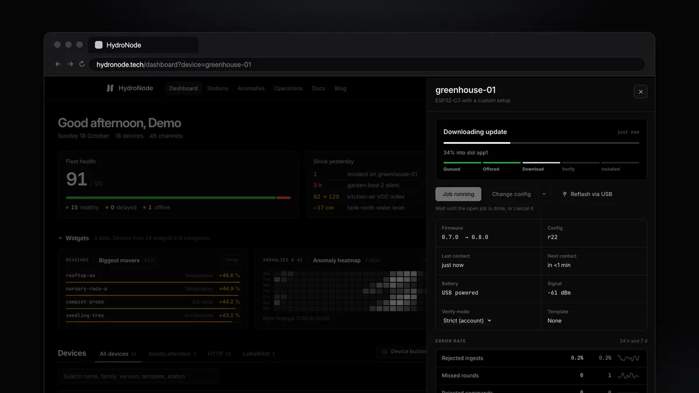
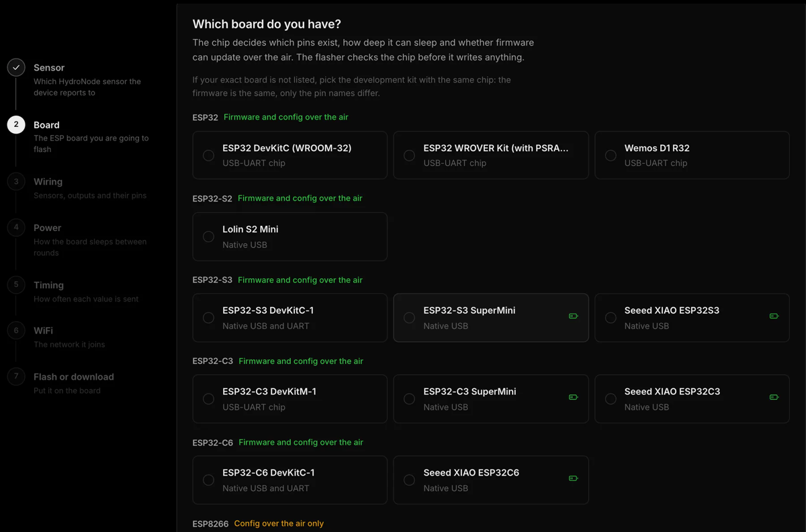

<div align="center">
  
  <h1>HydroNode Firmware</h1>
  <p><strong>Flash an ESP32 once from the browser. Every change after that goes over the air.</strong></p>

  [](https://github.com/TexhFexLabs/hydronode-firmware/actions/workflows/build.yml)
  [](https://github.com/TexhFexLabs/hydronode-firmware/releases/latest)
  [](LICENSE)
  [](#supported-boards)

  <p>
    <a href="https://hydronode.tech/?ref=gh-firmware"><strong>Website</strong></a> &nbsp;
    <a href="https://hydronode.tech/blog/esp32-c3-without-code/?ref=gh-firmware">Flash without code</a> &nbsp;
    <a href="https://hydronode.tech/blog/fleet-ota-updates/?ref=gh-firmware">Updates over the air</a> &nbsp;
    <a href="https://github.com/TexhFexLabs/HydroNode-Library">Arduino library</a> &nbsp;
    <a href="https://github.com/TexhFexLabs/hydronode-esphome">ESPHome component</a>
  </p>
</div>

---

Universal firmware for ESP32 and ESP8266 sensor boards that report to [HydroNode](https://hydronode.tech/?ref=gh-firmware),
a free platform for DIY sensors. You pick the board and the sensors you wired in the browser, flash once over USB, and from
then on new firmware, new sensors, other pins or another interval reach the board over the air. No reflashing over a cable.

<div align="center">
  
</div>

## What you get

- **One USB flash, then over the air.** Signed firmware updates on the ESP32 family, config updates on every board including the ESP8266.
- **Safe updates.** Images are signed with ECDSA P-256 (the release key lives on a YubiKey) and checked before a byte is written. A new image has to prove itself in its first round: WiFi up, a reading accepted by the server and, in Strict mode, every sensor read. Otherwise the board rolls back on its own and reports why.
- **No code.** The Device Builder plans pins, flags strapping pins, scans the I²C and 1-Wire bus, picks the most frugal power mode your parts allow and flashes over Web Serial from Chrome or Edge. The WiFi password goes to the board over USB and never to the server.
- **40+ sensors and outputs.** Climate, air quality, light, UV, gas, particulate matter, soil, water, rain, flow, battery gauges, relays, LEDs and buttons. The full list is in [`catalog/drivers.json`](catalog/drivers.json).
- **Low power.** Deep sleep, light sleep and modem sleep per board, rounds aligned to internet time, sensors powered down between readings. The builder shows the average current and battery life before you flash ([docs/POWER.md](docs/POWER.md)).
- **Your data where you want it.** Charts, alerts and anomaly detection in the web app, native iOS and Android apps with widgets, and Home Assistant through HACS. Free for up to 20 sensors.

## Quick start

You do not need to build this repository to use the firmware.

1. Create a free account and a sensor at [hydronode.tech](https://hydronode.tech/?ref=gh-firmware).
2. Open **Dashboard → Device builder**, pick your board and click the sensors you wired.
3. Plug the board in, press **Flash now** in Chrome or Edge. The first reading arrives as soon as it is on WiFi.

After that, **Change config** in the device drawer or a new firmware release reaches the board over the air.

<div align="center">
  
</div>

Guides with every step:

- [An ESP32-C3 sensor without writing a single line of code](https://hydronode.tech/blog/esp32-c3-without-code/?ref=gh-firmware)
- [Update every device over the air with Fleet](https://hydronode.tech/blog/fleet-ota-updates/?ref=gh-firmware): jobs, templates, verify modes and rollback
- [Device Builder reference](https://hydronode.tech/docs/features/device-builder/) and [Fleet reference](https://hydronode.tech/docs/features/fleet/)

## Supported boards

| Family | Boards in the builder | Firmware OTA | Config OTA |
|---|---|---|---|
| ESP32 | DevKitC (WROOM-32), WROVER Kit, Wemos D1 R32 | yes | yes |
| ESP32-S2 | Lolin S2 Mini | yes | yes |
| ESP32-S3 | DevKitC-1, S3 SuperMini, Seeed XIAO ESP32S3 | yes | yes |
| ESP32-C3 | DevKitM-1, C3 SuperMini, Seeed XIAO ESP32C3 | yes | yes |
| ESP32-C6 | DevKitC-1, Seeed XIAO ESP32C6 | yes | yes |
| ESP8266 | NodeMCU v2/v3, Wemos D1 mini | no (no second app slot) | yes |

One binary per chip family. Everything device specific (sensors, outputs, pins, interval, sleep mode, WiFi, sensor
credentials) lives in a small config block in its own flash partition (`hncfg`, on the ESP8266 at `0x3F8000`).

Prefer writing your own code? The [Arduino library](https://github.com/TexhFexLabs/HydroNode-Library) and the
[ESPHome component](https://github.com/TexhFexLabs/hydronode-esphome) speak the same signed protocol.

## Layout

| Path | Content |
|---|---|
| `src/` | firmware |
| `src/actuators/` | relays, LEDs, switched outputs and buttons, driven by HydroNode commands |
| `src/ota/` | updates over the air: offer checks, signed download, config merge, verify and rollback, trusted keys (`OtaKeys.h`) |
| `src/scanner/` | I²C and 1-Wire scanner (`scan-*` environments), flashed from the wiring step |
| `catalog/boards.json` | chip families, boards, pin rules, sleep modes, wake pins and currents per family, deep sleep current per board |
| `catalog/drivers.json` | supported sensors, buses, channels, options, timing and currents, sleep rules per power mode ([docs/POWER.md](docs/POWER.md)), `minFirmware` for drivers newer than 0.5.0 |
| `catalog/sleep-modes.json` | energy modes |
| `catalog/libraries.json` | every bundled library with exact version and SPDX license |
| `partitions/` | flash layout (`hncfg` at `0x390000`, 8 KB) |
| `tools/validate-catalog.mjs` | consistency check, writes `dist/catalog.json` for the web app |
| `tools/license-check.mjs` | license gate, writes `THIRD_PARTY_LICENSES.md` |
| `tools/encode-config.mjs` | reference encoder for the config block |
| `tools/package-release.py` | merged images, bare app images for OTA, `manifest.json`, `SHA256SUMS`, release zip |
| `tools/sign-release.sh` | signs every OTA image of a release (YubiKey or a PEM key), writes the `ota` blocks into the manifest |
| `tools/dev-keys/` | local dev signing key for tests (`make-dev-key.sh`, keys gitignored) |
| `tools/check-image-size.py` | fails when an image uses more than 85 % of its OTA slot |
| `catalog/fixtures/` | golden config blocks shared with the web encoder (`config-v1`, `config-v1-battery` with the 0.8.0 battery block) |
| `test/vectors/` | battery threshold rules shared with backend, web, library and station |

## Build

```bash
pip install platformio
pio run                      # all chip families plus the scanners
pio test -e native           # host tests (config, OTA logic, battery rules)
pio test -e native-ota       # OTA state machine and measurement loop on simulated hardware
node tools/validate-catalog.mjs --out dist
node tools/license-check.mjs --out dist/THIRD_PARTY_LICENSES.md
python tools/package-release.py   # merged images + manifest.json → dist/
```

A release tag `vX.Y.Z` (must match `version` in `platformio.ini`) runs the same steps in
CI and publishes `hydronode-firmware-X.Y.Z.zip` plus the Arduino core source. The OTA images are
signed afterwards, locally, with the release key on the YubiKey (see [docs/OTA.md](docs/OTA.md)).

For local OTA tests, build a firmware that trusts the dev key:

```bash
bash tools/dev-keys/make-dev-key.sh            # once, keys stay local
pio run -e esp32c3-dev                         # also esp32-dev, esp32s3-dev
python tools/package-release.py
bash tools/sign-release.sh --key tools/dev-keys/ota-dev.pem
```

## Serial status lines

The firmware prints machine readable lines at 115200 baud, all prefixed with `HN:`
(`BOOT`, `CFG`, `DEV`, `OUT`, `BTN`, `OW`, `ROUND`, `BATTERY`, `WIFI`, `SEND`, `SLEEP`, `ERR …`). The web
flasher shows them as a checklist. Secrets are never printed.

## Rounds and timing

The board measures in rounds, one per interval. A value can be sent every n-th round only
(`"n"` in the config). Rounds start on the interval, not interval plus awake time: the firmware
subtracts the time it was awake from the sleep. All values of a round go out in one request
(since 0.7.0, HydroNode-Library 1.7.0), stamped with the time they were read; on the ESP8266
(160 MHz) the handshake takes about 3 s, every further value adds a few bytes to the request.
Always on and modem sleep with rounds of a minute or less keep the TLS connection open from one
round to the next. `catalog/boards.json` carries these timings per family, the web app adds them up to the
fastest interval a configuration can keep.

## Battery and thresholds

From 0.8.0 on a config can describe the battery (`battery` block: source, chemistry, cells,
capacity, four thresholds). The board then saves energy below Save, switches WiFi and outputs off
below Recovery and sleeps an hour at a time below Standby, like the HydroNode station. Gauges
(MAX17043/48/49, LC709203F, BQ27441) and INA219/226/260 with charge counting measure the battery.
It reports interval and thresholds as `X-Device-Config`. Details: [docs/POWER.md](docs/POWER.md).

## Outputs and commands

Relays, LEDs and switched outputs listen to HydroNode commands named after the device
(`relay1`): `BOOL` switches, `UINT32` switches on for that many milliseconds (at most 24 h),
`<name>_level` (`UINT32`, 0–100) dims an LED. Commands arrive with the answer to a sent value,
so a board with outputs always sends at least one value (the WiFi signal costs nothing). A button
sends its press right away and can toggle an output on the same board.

## Updates over the air

From 0.5.0 on, the ESP32 family takes signed firmware updates over the air and every family, the
ESP8266 included, takes config updates. Getting there takes one USB flash with the device builder;
a board on an older version shows "needs USB once" in the fleet view.

| | ESP32, S2, S3, C3, C6 | ESP8266 |
|---|---|---|
| Firmware over the air | yes, signed images only | no, no room for a second app slot |
| Config over the air | yes | yes |

- The update is offered in the reply to a sent value and taken after the round, so no reading is
  lost. The board downloads the image itself, nothing reaches into its network.
- Every image is signed with ECDSA P-256. The board checks the signature against the keys compiled
  into the firmware before it writes a byte, and the SHA-256 while it writes.
- New firmware or config has to prove itself in its first wake cycle (Strict or Lenient),
  otherwise the board goes back to what it ran before and reports why.
- WiFi and the sensor secret never travel with a config update. The board keeps its own.
- Outputs keep their last state over a restart.
- Release builds trust only the keys in `src/ota/OtaKeys.h`: the release key `prod-2026-10`
  (`tools/release-keys/prod-2026-10.pub.pem`), which lives on a YubiKey.

Details, the wire format, signing with the YubiKey and the local dev key: [docs/OTA.md](docs/OTA.md).

## Scanner

`scan-<family>` builds a small firmware that answers serial commands: `I2C <sda> <scl>` lists
every I²C address that acknowledges, `OW <pin>` every 1-Wire ROM. The wiring step flashes it,
scans and suggests sensors from the catalog that use the found addresses.

## Licensing

The firmware source is MIT. Binaries also contain the Arduino core for ESP32 or ESP8266
(LGPL-2.1) and third-party libraries under MIT, BSD and Apache-2.0. Only libraries on
the allowlist in `catalog/libraries.json` may be linked; CI fails otherwise. Every
release ships `THIRD_PARTY_LICENSES.md` and the exact core source. You can rebuild and
relink the firmware from this repository with every dependency pinned.
